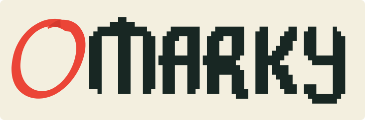
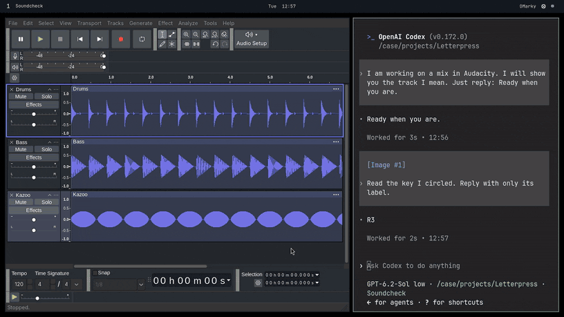

<p align="center"></p>

# “No, the *other* mute button.”

There are three mute buttons on your screen. You know which one you mean. Your agent has managed to narrow it down to three.

**Stop describing what you mean. Show your agent.** OMarky puts a red pen on your [Omarchy](https://omarchy.org) desktop. Circle the thing, add your question, and carry on in the chat you already have open.



[Install](#install) · [Connect your chat](#connect-your-chat) · [Set a shortcut](docs/shortcut.md)

## Keep the conversation

**Already working in Codex?** Pair that conversation once. The next time something looks off, open OMarky, circle it, and hit **Send**. The PNG and your note land in the chat you picked. The terminal that happens to have focus doesn't get a vote.

**Working in Claude Code, Grok, or another agent?** Click **For chat**. OMarky copies one message with your note and a reference to the marked picture. Paste it into your current chat and send it there. A local agent can open the PNG itself or fetch it with the [optional connection below](#connect-your-chat).

**Just want the picture?** **Copy** puts the marked PNG on your clipboard without contacting an agent. OMarky freezes the whole focused display, so crop first if the rest of the screen is nobody's business.

## Install

```sh
omarchy plugin add https://github.com/dumpsteredition/omarky.git --enable
```

Click the mark in your bar. If you're updating an existing install to get **For chat**, run `omarchy plugin update io.github.dumpsteredition.omarky`. No hotkey is required. Right-click the mark if you want to copy a suggested unused shortcut; you review and add the binding yourself.

## Connect your chat

**Without setup:** choose **For chat** on the welcome screen. Draw, click **Note** if you have a question, then click **For chat** on the canvas. Paste the resulting message into the conversation you want. It includes an absolute path to the **marked** PNG. If your local agent can read images at that path, you're done. For a web chat or an agent on another machine, use **Copy** and paste or attach the actual image in that chat; a path on your laptop won't work remotely. Either route needs a model that can see images.

### Codex: send directly

1. Click **Choose a chat**. If none are connected yet, click **Open Codex picker…**, open your existing conversation in Codex's own terminal, and click **Rescan** in OMarky. Leave that paired terminal open.
2. Choose the conversation by project and title. Circle any key on the practice card and press **Send**. The chat has to read that key from the picture before OMarky remembers it. Your desktop isn't in the test image.
3. Open OMarky over your work, mark it, then **Send**. The cog reopens setup. If the chosen chat disappears, OMarky won't pick another; if delivery is uncertain, check the chat before trying again.

[See the practice card](preview.png) · [Codex setup and troubleshooting](docs/codex.md)

### Claude Code, Grok, and other local agents: fetch the picture

If you'd rather not rely on image-path handling, register OMarky's **local MCP tool** once. The agent can then retrieve the PNG **and** your literal note using the card ID you paste. It can't browse your screenshots. Registration doesn't send a mark, launch a model, or change your default agent.

Open a terminal **on the same desktop, as the same user**. Set this once in that shell, then run the command for your client:

```sh
OMARKY="$HOME/.config/omarchy/plugins/io.github.dumpsteredition.omarky"
```

**Claude Code** — run this from the project where you want the connection. `--scope local` keeps the registration private to you in this project.

```sh
claude mcp add --transport stdio --scope local omarky -- \
  /usr/bin/env "XDG_RUNTIME_DIR=${XDG_RUNTIME_DIR:-}" /usr/bin/python3 "$OMARKY/bin/omarky-mcp"
claude mcp get omarky
```

Look for **Connected**. Check `/mcp` in Claude Code. If the current session hasn't picked up the server, reopen Claude Code in that project and resume **the same conversation**. [Claude Code's MCP documentation](https://code.claude.com/docs/en/mcp)

**Grok** — this registers the reader in your Grok user configuration:

```sh
grok mcp add omarky -- \
  /usr/bin/env "XDG_RUNTIME_DIR=${XDG_RUNTIME_DIR:-}" /usr/bin/python3 "$OMARKY/bin/omarky-mcp"
grok mcp doctor omarky
```

Look for a successful handshake and **one tool discovered**. In the open Grok chat, use `/mcps` and press `r` to refresh. [Grok's MCP documentation](https://docs.x.ai/build/features/mcp-servers)

**Another local client:** add a **stdio** server named `omarky`. Set the executable to `/usr/bin/python3`, its single argument to the **absolute** path printed by `printf '%s\n' "$OMARKY/bin/omarky-mcp"`, and its `XDG_RUNTIME_DIR` environment value to the one from your desktop shell. The single tool is `read_annotation`; its argument is `card_id`. Both processes need access to the same local card directory. A restricted or text-only client may still require you to attach the PNG manually.

**Try the connection:** draw on something recognizable, type a question like “Which button did I circle?”, and click **For chat**. Paste that message into the chosen conversation, submit it, and approve the tool call there if asked. The answer should identify what you circled. A green connection check by itself only proves the tool is reachable.

### Privacy and cleanup

- **Send** uses your paired Codex session's normal model, account, and permissions. **For chat** prepares a card; you decide which conversation gets it. A local tool connection doesn't mean the model runs offline.
- Cards contain the marked (or cropped) PNG and the note. They live in owner-private directories under `$XDG_RUNTIME_DIR/omarky/cards`, or `~/.cache/omarky/cards` if no runtime directory is set. The reader rejects cards after **30 minutes**. Old files are pruned on the next card operation, not by a timer. Clipboard history or a chat that already received the image can retain its own copy.
- To remove a card immediately, run `"$OMARKY/bin/omarky-forget" CARD_ID` with the ID from the handoff. `"$OMARKY/bin/omarky-forget" --all` clears all OMarky cards for this user, not your chats.

## Requirements and removal

OMarky is a community Quickshell bar plugin for Omarchy/Hyprland (`io.github.dumpsteredition.omarky`). Review Omarchy's installation prompt: third-party plugins run with your user's permissions. The canvas needs Python 3, `python-gobject`, `python-cairo`, `gtk3`, `gtk-layer-shell`, `hyprctl`, `grim`, and `wl-clipboard`. The optional MCP reader needs only Python's standard library. Direct **Send** requires a signed-in, image-capable Codex CLI. Nothing switches agents, installs dependencies, or overwrites keybindings for you.

Before uninstalling, close any paired terminal, clear any cards you want deleted now, and remove any optional registration you added (`claude mcp remove omarky --scope local` from that project, or `grok mcp remove omarky`). Then:

```sh
omarchy plugin disable io.github.dumpsteredition.omarky
omarchy plugin remove io.github.dumpsteredition.omarky
```

Remove your optional shortcut if you added one. Verified destination preferences live in `${XDG_CONFIG_HOME:-$HOME/.config}/omarky/`. Removing OMarky doesn't delete agent conversations.

## Development

```sh
omarchy plugin validate .
/usr/bin/python3 -B -m unittest discover -s tests
```

The marking canvas grew out of Rare Tools. The lettering nods to [Omarchy's wordmark](https://github.com/omacom/omarchy/blob/master/logo.svg); the red O is a pen stroke. OMarky is independent of Omarchy, OpenAI, Anthropic, and xAI. [MIT license](LICENSE).
